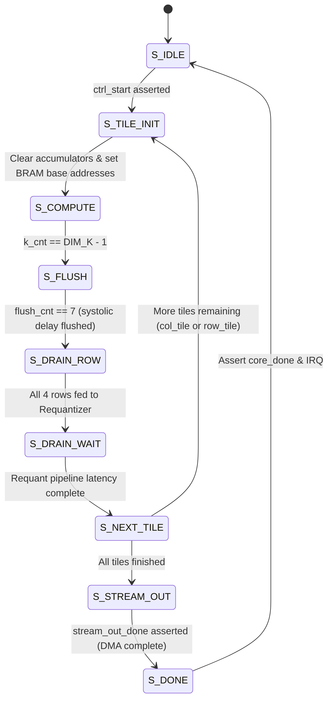

# EdgeGuard Hardware Microarchitecture Specification

## 1. Executive Summary & SoC Block Diagram

**EdgeGuard** is a synthesizable, high-efficiency deep learning inference accelerator specifically engineered for Xilinx 7-Series SoCs (specifically the **Zynq-7020 XC7Z020-1CLG400C** on the **Digilent PYNQ-Z2**). The architecture executes quantized neural networks using an optimized **INT8 $\times$ INT8 $\to$ INT32 Systolic Array**, coupled with on-chip Block RAMs (BRAM), an automated streaming buffer controller, and a 4-channel pipelined requantization and activation engine.

```
                           +-------------------------------------------------------+
                           |               ZYNQ-7000 PROCESSING SYSTEM            |
                           |  Dual ARM Cortex-A9 @ 650 MHz | 512 MB DDR3 Memory    |
                           +-------------------------------------------------------+
                                      | AXI_GP0 (MMIO)              | AXI_HP0 (DMA)
                                      v                             v
+-----------------------------------------------------------------------------------------------+
| PROGRAMMABLE LOGIC (PL) - EDGEGUARD AI ACCELERATOR                                            |
|                                                                                               |
|  +---------------------+        +--------------------+       +-----------------------------+  |
|  |   AXI4-Lite CSR     |        |   AXI DMA Engine   | <---> |  Stream Buffer Controller   |  |
|  |  (Config & Status)  |        |  (MM2S & S2MM)     |       |  (Stream-to-BRAM / BRAM-Out)|  |
|  +---------------------+        +--------------------+       +-----------------------------+  |
|             | Control                                                       |                 |
|             v                                                               v                 |
|  +-----------------------------------------------------------------------------------------+  |
|  |                                  ON-CHIP MEMORY SUBSYSTEM                               |  |
|  |  [Input BRAM: 2KB]         [Weight BRAM: 4KB]         [Bias BRAM: 1KB]  [Out BRAM: 2KB] |  |
|  +-----------------------------------------------------------------------------------------+  |
|             |                              |                                                  |
|             | Activations (Rows)           | Weights (Cols)                                   |
|             v                              v                                                  |
|  +---------------------------------------------------------+                                  |
|  |       INPUT SKEW REGISTERS (Wavefront Alignment)        |                                  |
|  |  Row 0: 0d | Row 1: 1d | Row 2: 2d | Row 3: 3d          |                                  |
|  +---------------------------------------------------------+                                  |
|             |                                                                                 |
|             v                                                                                 |
|  +---------------------------------------------------------+                                  |
|  |                  4x4 SYSTOLIC MAC ARRAY                 |                                  |
|  |  PE(0,0) ---> PE(0,1) ---> PE(0,2) ---> PE(0,3)          |                                  |
|  |    |            |            |            |             |                                  |
|  |    v            v            v            v             |                                  |
|  |  PE(1,0) ---> PE(1,1) ---> PE(1,2) ---> PE(1,3)          |                                  |
|  |    |            |            |            |             |                                  |
|  |    v            v            v            v             |                                  |
|  |  PE(2,0) ---> PE(2,1) ---> PE(2,2) ---> PE(2,3)          |                                  |
|  |    |            |            |            |             |                                  |
|  |    v            v            v            v             |                                  |
|  |  PE(3,0) ---> PE(3,1) ---> PE(3,2) ---> PE(3,3)          |                                  |
|  +---------------------------------------------------------+                                  |
|             | 4 x INT32 Row Drain Bus                                                         |
|             v                                                                                 |
|  +---------------------------------------------------------+                                  |
|  |    4-CHANNEL REQUANTIZATION & ACTIVATION PIPELINE       |                                  |
|  |    - Stage 1: INT32 Bias Addition (Sum = Acc + Bias)    |                                  |
|  |    - Stage 2: Q15 Fixed-Point Scaling (Sum * M0)        |                                  |
|  |    - Stage 3: Rounding, Arithmetic Shift (>>> n)        |                                  |
|  |    - Stage 4: Non-Linear ReLU & Saturation [-128, 127]  |                                  |
|  |    - Output Packer: 4 x INT8 -> 32-bit Stream Word      |                                  |
|  +---------------------------------------------------------+                                  |
+-----------------------------------------------------------------------------------------------+
```

---

## 2. Microarchitecture Details

### 2.1 Processing Element (PE) Architecture
Each PE in the $4 \times 4$ grid performs a pipelined multiply-accumulate on signed 8-bit integers, accumulating into a signed 32-bit register:

$$\text{Product} = A_{\text{in}} \times B_{\text{in}} \quad (\text{INT8} \times \text{INT8} \to \text{INT16 signed})$$
$$\text{Accum} = (\text{clr\_acc}) \ ? \ \text{Product} : (\text{Accum} + \text{Product}) \quad (\text{INT32 signed})$$

- **Wavefront Operand Forwarding:**
  - $A_{\text{out}} \leftarrow A_{\text{in}}$ (registered, passes to the East neighbor on clock edge)
  - $B_{\text{out}} \leftarrow B_{\text{in}}$ (registered, passes to the South neighbor on clock edge)
- **DSP48E1 Mapping:**
  In Xilinx 7-Series FPGAs, a single DSP48E1 slice contains a $25 \times 18$ two's-complement multiplier followed by a 48-bit accumulator ($P = P + A \times B$). Each `systolic_pe` directly maps to one DSP48E1 slice without requiring external carry logic or pipeline LUTs, allowing operation above $125\text{ MHz}$.

### 2.2 Systolic Array Wavefront Timing & Skewing
To achieve 100% data reuse without memory read contention:
- Row $i$ of activations is delayed by $i$ clock cycles:
  $$\text{Delay}(A_i) = i \quad \text{cycles} \quad (i \in \{0, 1, 2, 3\})$$
- Column $j$ of weights is delayed by $j$ clock cycles:
  $$\text{Delay}(B_j) = j \quad \text{cycles} \quad (j \in \{0, 1, 2, 3\})$$

At clock cycle $t = i + j + k$, PE$(i,j)$ evaluates the $k$-th inner-product term. A tile computation of inner dimension $K$ requires:
$$T_{\text{compute}} = K + 2 \times (\text{ARRAY\_SIZE} - 1) = K + 6 \quad \text{cycles}$$

### 2.3 4-Channel Pipelined Requantization & Activation
The output of the systolic accumulator is 32-bit signed. To prepare activations for the subsequent layer, the requantizer applies fixed-point scaling, bias addition, rounding, and non-linear clipping:

$$Y = \text{Clip}\left(\text{ReLU}\left(\left\lfloor \frac{(S + \text{Bias}) \times M_0 + 2^{n-1}}{2^n} \right\rfloor\right), -128, 127\right)$$

- **Stage 1 (Cycle 1):** Signed 33-bit addition: $S + \text{Bias}$.
- **Stage 2 (Cycle 2):** $33 \times 16$-bit signed multiplication with fixed-point scale $M_0$.
- **Stage 3 (Cycle 3):** Symmetric rounding offset addition and arithmetic right shift by $n$.
- **Stage 4 (Cycle 4):** Conditional zeroing for ReLU activation, followed by saturation clamping to $[-128, 127]$.
- **Packing:** 4 parallel channels produce four 8-bit outputs simultaneously, forming a 32-bit word written directly to Output BRAM or streamed out via AXI-Stream.

---

## 3. Register Map (AXI4-Lite Interface)

The accelerator is mapped to the ARM Cortex-A9 address space via the General Purpose AXI master port (`M_AXI_GP0` at base address `0x4000_0000`).

| Offset | Register Name | R/W | Description |
|:---|:---|:---:|:---|
| `0x00` | `REG_CTRL` | R/W | Control Register:<br>• Bit 0: `start` (pulse 1 to initiate inference)<br>• Bit 1: `soft_reset` (active high)<br>• Bit 2: `irq_en` (interrupt enable)<br>• Bit 3: `clear_done` |
| `0x04` | `REG_STATUS` | RO | Status Register:<br>• Bit 0: `busy`<br>• Bit 1: `done`<br>• Bit 2: `error`<br>• Bits [23:16]: FSM Current State |
| `0x08` | `REG_DIM_M` | R/W | Matrix M Dimension (Batch Size / Rows, default = 4) |
| `0x0C` | `REG_DIM_K` | R/W | Matrix K Dimension (Reduction / Features, e.g., 64, 32, 16) |
| `0x10` | `REG_DIM_N` | R/W | Matrix N Dimension (Output Neurons, e.g., 32, 16, 4) |
| `0x14` | `REG_QUANT_SCALE` | R/W | 16-bit Fixed-Point Quantization Multiplier $M_0$ |
| `0x18` | `REG_QUANT_SHIFT` | R/W | 5-bit Arithmetic Right Shift Amount $n$ (0..31) |
| `0x1C` | `REG_LAYER_CFG` | R/W | Layer Configuration:<br>• Bit 0: `relu_en`<br>• Bits [15:8]: `clip_min` (signed INT8, e.g., -128)<br>• Bits [23:16]: `clip_max` (signed INT8, e.g., 127) |
| `0x20` | `REG_PERF_CYCLES` | RO | 32-bit Hardware Cycle Counter (exact execution latency in PL clock cycles) |
| `0x24` | `REG_IRQ_CFG` | R/W | Interrupt configuration |

---

## 4. Finite State Machine (FSM) Flow



---

## 5. Performance Metrics Summary

- **Clock Frequency ($F_{\text{clk}}$):** 100 MHz (10.0 ns period, verified timing clean on -1 speed grade)
- **Peak Throughput:** 16 PEs $\times$ 2 OPs/cycle $\times$ 100 MHz = **3.2 GOPS**
- **Layer 1 Latency (64 $\to$ 32):** $\approx 640$ cycles ($6.4\ \mu\text{s}$)
- **Layer 2 Latency (32 $\to$ 16):** $\approx 160$ cycles ($1.6\ \mu\text{s}$)
- **Layer 3 Latency (16 $\to$ 4):** $\approx 40$ cycles ($0.4\ \mu\text{s}$)
- **Total Network Inference Latency:** **$< 10\ \mu\text{s}$**
- **Speedup over ARM Cortex-A9 CPU:** **$> 40\times$**
